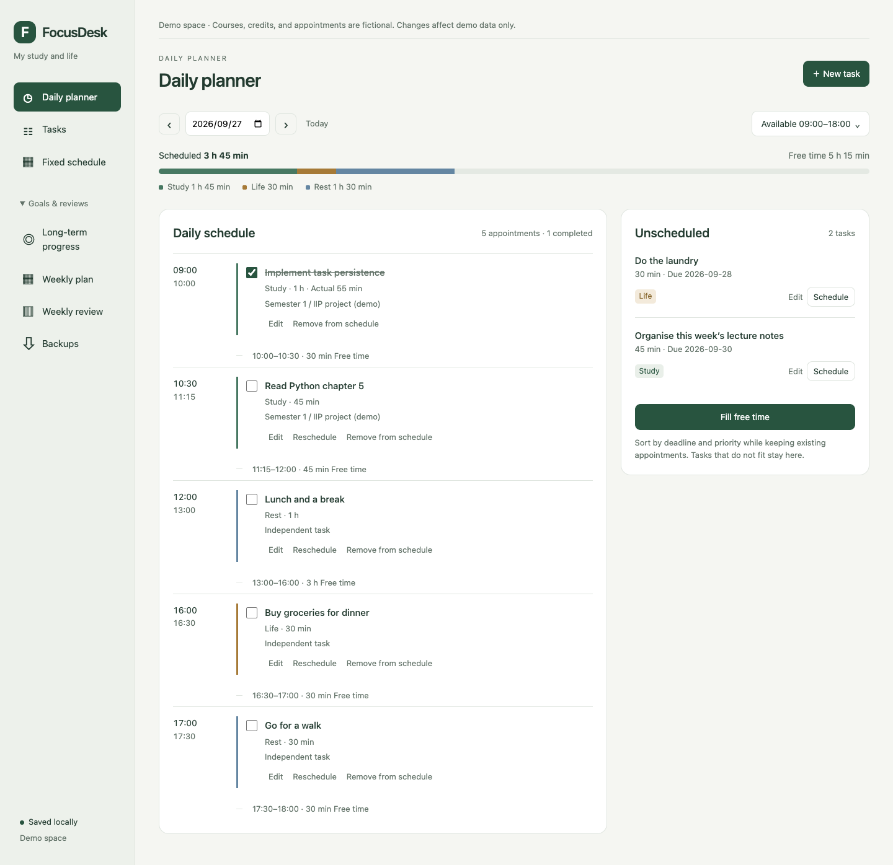
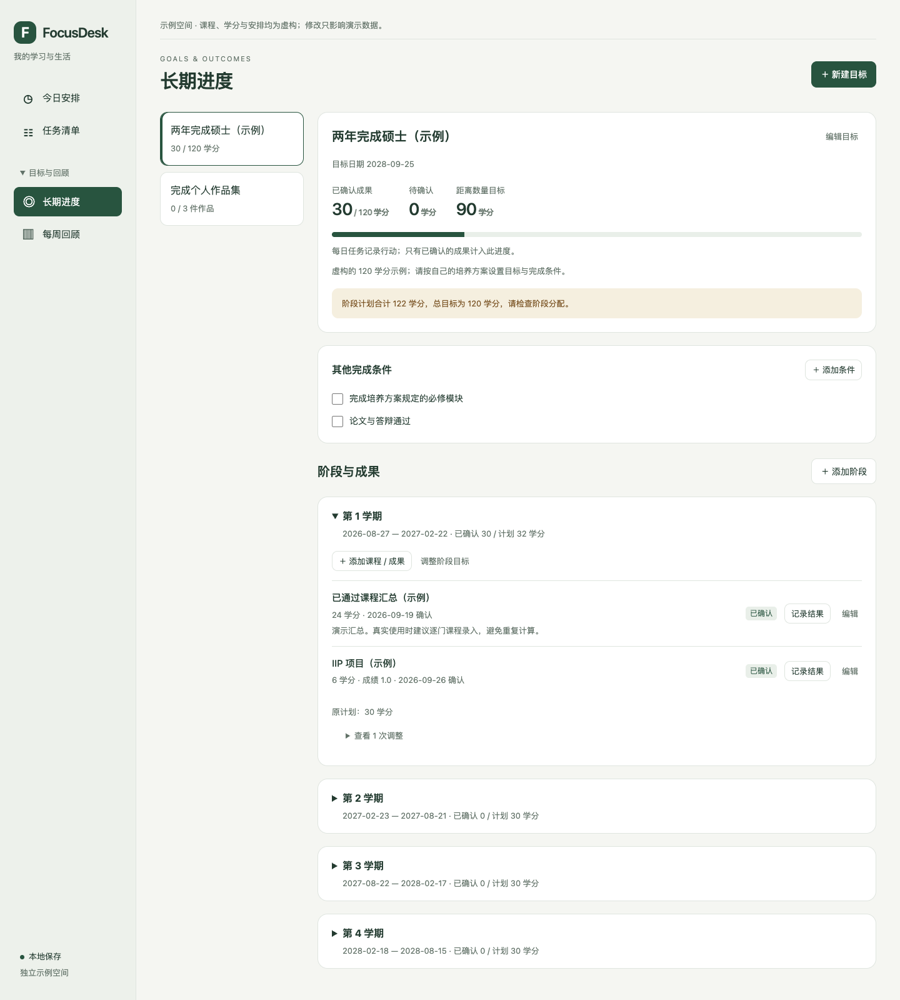

# FocusDesk

Current local release: **0.2.0**, 2026-09-26. Maintained by **sxran**.

FocusDesk is a local study-and-life workbench written in Python. Its home page
shows **the selected day's time allocation and schedule**. Long-term progress
lives under **目标与回顾 → 长期进度**.

A task represents effort. A confirmed course result represents an outcome.
Completing a study task never awards academic credits. Goals, stages, courses,
tasks, schedules and recorded results are saved in SQLite on your computer.

This is an *Introduction to Python* final project, targeting Python 3.10+.
The interface is in Chinese. See [the beginner's guide](docs/GETTING_STARTED_ZH.md)
for a walkthrough and [the course checklist](docs/COURSE_CHECKLIST.md) for scope.

## Install and run

Install [uv](https://docs.astral.sh/uv/), then run these commands from this folder:

```sh
uv venv --python 3.12
uv pip install -e .
uv run -m focusdesk serve
```

Open **http://127.0.0.1:8765** in your browser. The first personal run starts empty.
Stop the server with Ctrl+C. There is no account, API key or JavaScript build step.
The server binds to loopback only; it is a local, single-user application.

To explore fictional data without changing your personal database:

```sh
uv run -m focusdesk --demo serve
```

The demo illustrates a fictional 120-credit goal over four stages. It does not
represent any particular university's degree requirements. Edit targets and
conditions according to your actual programme. The demo is seeded once; later
launches preserve changes made to it.

If port 8765 is in use, stop the previous server or choose another port:

```sh
uv run -m focusdesk serve --port 8767
```

Global options (`--db`, `--demo`) go **before** the command. Use an absolute path
with `--db` when launching from different directories; the default paths are
relative to your current working directory.

## What works

- **今日安排**: choose a day and available hours; schedule tasks at specific times;
  see study, life, rest and free time; reject overlapping/out-of-range blocks;
  fill remaining gaps without moving existing appointments.
- **任务清单**: create, edit, delete, complete and reopen tasks; record actual minutes;
  assign categories, priorities, deadlines and optional outcome links.
- **长期进度**: create/edit quantified goals; add stages and courses/outcomes;
  confirm results, dates and optional grades; track additional completion
  conditions such as mandatory modules or a thesis.
- **Plan revision**: preserve each stage's original target and log target changes.
  Show shortfalls after a stage ends, while distinguishing pending results.
- **每周回顾**: review completed work, planned/actual time and estimate differences;
  download a Markdown report, schedule CSV and SVG chart.

Initial prototype screenshots (v0.2.0 adds weekly planning, fixed schedules and backups):





## Planning and progress rules

The hierarchy is `Goal → Milestone → Outcome ← Task`. For a degree this maps to
`Graduation → Semester → Course ← Daily study`. Independent life tasks need no
goal. A goal has a quantity and unit, and may have additional checklist conditions.

Only outcomes with status `passed` contribute their amount. A repeated save
updates the same row, so credits are not accumulated twice. Returning a result
to `pending` or `failed` removes its contribution. Completion requires the
quantity target **and** every configured additional condition. This is progress
against the user's settings, not an official declaration of graduation.

Create a course once and update that same result for corrections or a retake.
The app does not import university records, infer passing grades or verify the
evidence externally. Confirmed amounts cannot be silently edited: restore the
result to pending, correct the amount, then confirm it again.

Automatic scheduling sorts by earliest deadline, then highest priority, then
stable task ID, and places each whole task in the first gap that fits. It is a
transparent heuristic, not a guarantee of an optimal schedule or meeting every
deadline. Unplaced tasks remain visible. Tasks scheduled on another day are
excluded from automatic planning; use the carryover panel or task list to move
them directly to another date/time. Changes retain the previous appointment. Completed blocks
remain in the plan so completing work does not incorrectly create free time.

Each task has at most one block. To spread a project over multiple days, create
separate actionable tasks. Changing a scheduled task's estimated duration
requires removing its block first. A day's availability is one interval; add
rest/life tasks for breaks. Overnight schedules remain unsupported. Weekly fixed appointments can reserve
classes, work and breaks over a bounded date range (up to 366 days).

## Headless CLI examples

The package works without a desktop browser and exposes the course's required
`python -m` entry point:

```sh
uv run -m focusdesk --help
uv run -m focusdesk add "Review chapter 3" --minutes 45 --category study --priority 3
uv run -m focusdesk tasks
uv run -m focusdesk done 1 --minutes 40
uv run -m focusdesk plan --date 2026-09-26
uv run -m focusdesk summary
uv run -m focusdesk report --output generated
```

`done` defaults to the task estimate if `--minutes` is omitted; provide the actual
time for accurate reports. Marking the same task done twice preserves its first
completion record. Reopening clears its completion time and actual minutes.

`report` defaults to the current Monday–Sunday week; `--date YYYY-MM-DD` selects
a different week. Planned time belongs to the block's date, while actual time
belongs to the local date on which completion was recorded. Therefore the two
totals need not describe exactly the same set of tasks. Goal values in the report
are a current snapshot, not a historical reconstruction.

Generated files (also available as browser downloads):

- `generated/focusdesk-report.md` — totals and current confirmed goal progress.
- `generated/focusdesk-schedule.csv` — that week's scheduled blocks, including
  status and actual minutes if completed. Unscheduled work is excluded from this
  CSV but included in the weekly actual-time totals.
- `generated/focusdesk-week.svg` — saved chart of actual daily minutes.

Small fictional sample outputs are included in [examples/report](examples/report).
The SVG is a self-contained image file; it does not require a display server.

## Import the Python API

```python
from focusdesk import Task, Workbench, suggest_schedule

task = Task("Read lecture notes", minutes=45, category="study")
desk = Workbench("data/my-workbench.sqlite3")
task_id = desk.add_task({"title": task.title, "minutes": task.minutes})
desk.schedule_task("2026-09-26", {"task_id": task_id, "start": "09:00"})
snapshot = desk.snapshot("2026-09-26")
print(snapshot["blocks"])
```

`Task`, `TimeBlock`, `ValidationError`, `Workbench`, `free_intervals` and
`suggest_schedule` are available from the top-level package. Scheduling and
progress calculations are Python functions shared by the CLI and web interface.

## Project structure

```text
src/focusdesk/
  __init__.py       Public import API
  __main__.py       Module entry point
  cli.py            CLI parsing and commands
  models.py         Validated Task and TimeBlock classes
  database.py       SQLite schema and transactions
  planner.py        Deterministic gap-filling algorithm
  service.py        Application rules and progress aggregation
  analytics.py      Weekly analysis and file exports
  demo.py           Explicit fictional demonstration data
  web.py            Flask application and JSON endpoints
  templates/        Page structure
  static/           CSS, browser interactions and favicon
tests/              Domain, concurrency, persistence and HTTP tests
docs/               Usage, design, screenshots and course checklist
examples/report/    Small generated demonstration outputs
```

Python owns validation, relationships, scheduling, persistence, aggregation and
reporting. The small JavaScript client renders the interface and submits forms.
Flask is the only runtime dependency; SQLite is part of the Python standard
library. No external dataset or network service is needed after installation.

## Development and verification

See the [changelog](CHANGELOG.md), [dated development log](docs/DEVELOPMENT.md),
[verification record](docs/VALIDATION.md) and [remaining work](docs/ROADMAP.md).
The development notes describe each milestone and the checks recorded for it.

```sh
uv sync --dev
uv run pytest
uv run ruff check src tests
uv run ruff format --check src tests
uv build
```

Tests cover the effort/outcome distinction, repeat-result idempotency, additional
goal conditions, revision history, invalid values, time conflicts, concurrent
booking, persistence, exports and protected JSON writes. The browser workflow
has also been exercised with isolated fictional data at desktop, 390px and
320px widths. The code is checked with Python 3.12; the minimum supported syntax
is Python 3.10.

## Storage and current boundaries

Personal data: `data/focusdesk.sqlite3`. Demo data: `data/demo.sqlite3`.
These files and the default personal report directory `generated/` are ignored
by version control; fictional examples remain tracked in `examples/report/`.
Close the server before copying
the entire `data/` folder as a backup. Nothing is uploaded to Drive or a server.

The application is for one person on one computer. It has no login, calendar
synchronisation, recurring task completion, automatic retake planning or
cross-midnight blocks. Confirmations are entered manually. Goal/stage/outcome deletion remains unavailable; completed goals can be archived
and restored. Edit stage dates or move an outcome between stages of the same
goal while preserving its ID, result, tasks and weekly targets. Its earned amount
belongs to the destination stage exactly once; the recorded confirmation date
is retained. Cross-goal course transfers are deliberately rejected.

I am preparing the project locally before publishing it. Course submission
still needs a public GitHub repository and its URL submitted in Moodle.

## Optional browser acceptance checks

`scripts/browser_smoke.cjs` creates a temporary database and loopback server,
checks the UI, and closes the server afterward. With Node.js and Playwright
installed, run `node scripts/browser_smoke.cjs`. If Playwright is installed
elsewhere, set `PLAYWRIGHT_MODULE` to its module path. Set `CHROME_EXECUTABLE`
to an installed Chrome binary if not using Playwright's bundled browser, and
`FOCUSDESK_PYTHON` if the Python executable is not `.venv/bin/python`.

## Weekly planning

Under 本周计划, set explicit effort targets for each course and Monday–Sunday
week. A 360-minute target with 120 scheduled minutes shows a 240-minute gap.
Recorded actual time is separate and never increases credits. Remaining capacity
excludes past dates and elapsed minutes today. Course-wide open
task estimates include other weeks and do not automatically become weekly targets.

## Fixed weekly appointments

固定课表 creates one weekly occurrence within an explicit start/end date range.
Every occurrence must fit that day's availability and avoid existing appointments;
any conflict rejects the whole rule. Cancel one occurrence for an exception, or
stop today's and future occurrences while keeping past appointments. All planners
respect fixed time, and weekly reports/CSV include it as planned time. Fixed time
does not automatically count as completed effort or earned credit.

## Goal maintenance and backups

Use 编辑阶段 to change dates/title/target and 编辑 on a course to change its
stage within the same goal. Reuse the same course for a retake; do not create a
duplicate credit-bearing result. Archived goals remain available under 已归档;
unarchive before editing their details or results.

数据备份 exports a versioned JSON containing all application tables, including
weekly targets, fixed appointments and audit history. Restore accepts files up to
8 MB, validates their schema, relationships, dates and schedule invariants in a
temporary database, then replaces the current space in one transaction. It is a
full replacement, not a merge. Demo and personal backups cannot be mixed.

Before replacement, a complete recovery copy is saved next to the database in
`<database-filename>.backups/`. Download it from the same page if needed. If that
copy cannot be saved, restoration does not proceed. Keep downloaded copies
private. Existing v0.1 databases migrate on startup without clearing their data.

The development notes describe the feature milestones and their checks.
